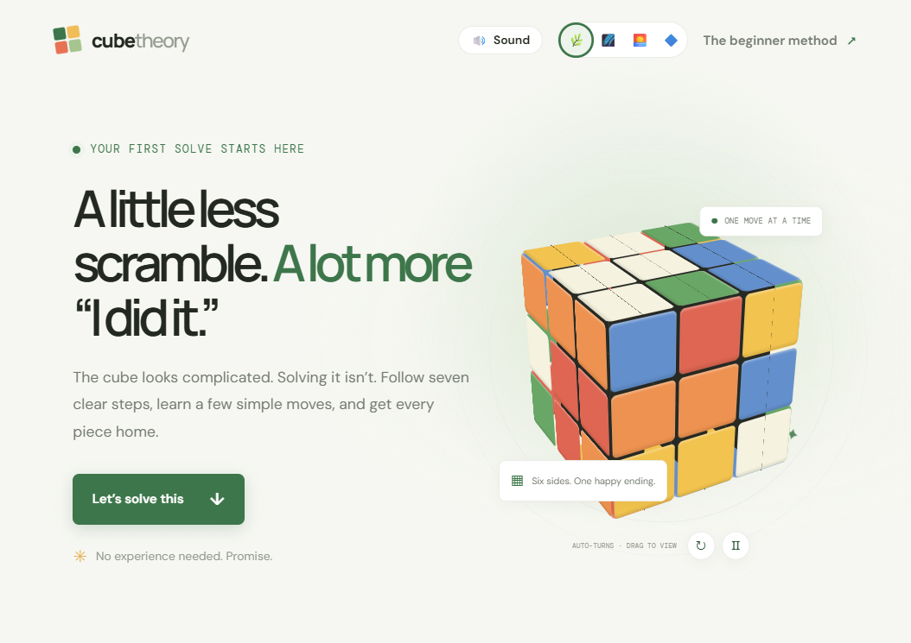
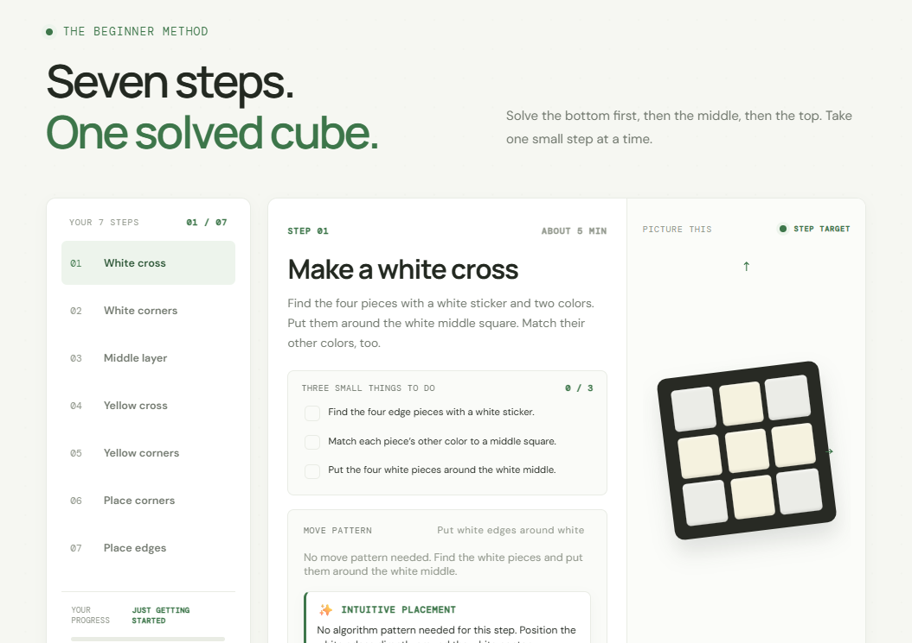

# Cube Theory
abdsc
Cube Theory is a visual, beginner-friendly guide to solving a standard 3×3 Rubik's Cube. It breaks the beginner method into seven short lessons, with plain-language instructions, illustrated targets, move patterns, and a checklist for each step.

## Screenshots

The landing page introduces the guide, and the lesson view walks through each step with an interactive checklist and cube illustration.

## Open the guide

This is a static website; no package installation or build step is required.

1. Download or open this project folder.
2. Open `index.html` in a modern web browser.
3. Select **Let’s solve this** to jump to the lessons.

You can also open the folder in a code editor and use a local static-file server if you prefer. The site uses Google Fonts when an internet connection is available and falls back to system fonts when it is not.

## The seven steps

1. **Make a white cross** — place the white edge pieces around the white center and match their other colors to the side centers.
2. **Finish the white layer** — insert the four white corners.
3. **Fill the middle layer** — insert the top-layer edges without yellow into the left or right gaps.
4. **Make a yellow cross** — turn the yellow edge stickers face up.
5. **Turn yellow corners up** — orient the remaining yellow corner stickers.
6. **Put yellow corners in place** — match each corner to the centers around its slot.
7. **Line up the last edges** — cycle the remaining top-layer edges to finish the cube.

Follow the instructions and diagrams for the current step. The checklist is a personal progress aid; check off an item when you have completed it on your physical cube.

## Interactive features

- Choose a lesson from the step list, or move forward and backward with the lesson buttons.
- On phones, choose from seven equal-width numbered step buttons; the current lesson title and instructions appear in the lesson card.
- Check off lesson tasks to track completed steps and overall progress.
- Play, pause, and resume move-by-move demonstrations. Select an individual move or use the previous/next move buttons to review it.
- Choose the left or right insertion pattern for the middle layer, or a direction for the final edge cycle.
- Watch the large cube spin continuously as its layers rearrange: each face turn carries its nine cubelets and stickers together, like a real Rubik’s Cube. The cubelets touch with narrow black seams rather than extra gaps. Drag it or use the arrow keys to change your view while the cube keeps spinning; use the animation button to pause or resume motion, and the rotate button to turn the view by a quarter-turn.
- Choose a color theme and toggle sound effects from the header. The selected theme is saved in this browser.
- Most animations honor the device's reduced-motion setting. The requested cube spin and layer turns start automatically; use the pause button to stop them.

## Mobile support

The layout adapts to phone, tablet, and desktop screens. On narrow screens, the lesson list becomes a row of seven numbered buttons that stays within the screen width; tap a number to open that step. The lesson text, checklist, move controls, and cube illustration stack vertically for easier reading and touch use.

## Move notation

The letter names the face to turn, viewed straight on:

| Letter | Face |
| --- | --- |
| `R` | Right |
| `L` | Left |
| `U` | Upper (top) |
| `D` | Down (bottom) |
| `F` | Front |

A plain letter means a clockwise quarter-turn. An apostrophe (`′`) means a counterclockwise quarter-turn. A `2` means a half-turn (180 degrees).

## Project files

- `index.html` — page content and accessible controls.
- `styles.css` — visual design, animations, themes, and responsive layouts.
- `app.js` — lesson content, navigation, move demonstrations, cube controls, theme selection, and sound effects.

The cube artwork and lesson diagrams are visual teaching aids; the site does not read or simulate the current state of a physical cube.
